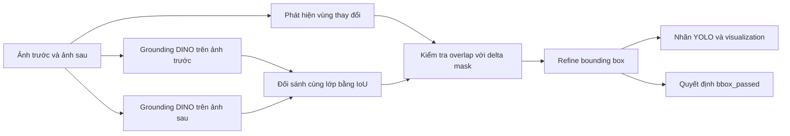

# BÁO CÁO PHƯƠNG PHÁP VÀ KẾT QUẢ THỰC NGHIỆM

**Sinh viên:** [Điền họ tên]  
**MSSV:** [Điền MSSV]  
**Nhóm:** [Điền tên hoặc số nhóm]  
**Giảng viên hướng dẫn:** [Điền tên giảng viên]  
**Ngày báo cáo:** 18/10/2026

## 1. Phương pháp

### 1.1. Tổng quan

Phần bounding box nhận đầu vào là các cặp ảnh trước và sau chỉnh sửa. Ảnh trước thể hiện bối cảnh thiên tai ban đầu; ảnh sau chứa các hoạt động hoặc phương tiện cứu hộ được bổ sung. Mục tiêu của phương pháp là phát hiện các đối tượng cứu hộ mới xuất hiện, loại các detection thuộc vùng nền không thay đổi và xuất pseudo-label theo định dạng YOLO.

Pipeline gồm bốn bước chính:

1. Phát hiện vùng thay đổi giữa ảnh trước và ảnh sau.
2. Dùng Grounding DINO phát hiện đối tượng cứu hộ trên cả hai ảnh.
3. Đối sánh detection trước–sau và xác nhận đối tượng mới bằng delta mask.
4. Refine bounding box, xuất nhãn YOLO và quyết định pass/fail cho từng cặp.



### 1.2. Phát hiện vùng thay đổi

Hai ảnh được chuyển sang RGB. Nếu kích thước khác nhau, ảnh sau được resize về kích thước ảnh trước. Sai khác cường độ tại mỗi pixel được tính từ trị tuyệt đối sai khác ba kênh:

\[
D = 0.299|R_a-R_b| + 0.587|G_a-G_b| + 0.114|B_a-B_b|
\]

Trong đó \(a\) và \(b\) lần lượt biểu diễn ảnh sau và ảnh trước. Ngưỡng nhị phân được xác định thích nghi bằng Otsu và được giới hạn trong khoảng cấu hình:

\[
T = \max(25, \min(T_{Otsu}, 60))
\]

Mặt nạ nhị phân tiếp tục qua phép đóng rồi mở hình thái học với kernel \(7 \times 7\). Bước này lấp các lỗ nhỏ và loại nhiễu rời rạc. Các thành phần liên thông được chuyển thành bounding box delta. Thành phần quá nhỏ bị loại theo diện tích tối thiểu:

\[
A_{min} = \max(100, A_{image} \times 0.01 / 5)
\]

Một thay đổi được xem là hợp lệ khi:

- tỷ lệ pixel thay đổi nằm trong khoảng từ 1% đến 60% diện tích ảnh; và
- có ít nhất một thành phần liên thông hợp lệ.

Giới hạn dưới loại các thay đổi quá nhỏ hoặc nhiễu. Giới hạn trên loại trường hợp ảnh sau thay đổi gần như toàn bộ bố cục, khiến việc xác định đối tượng mới không còn đáng tin cậy.

### 1.3. Phát hiện đối tượng cứu hộ

Pipeline sử dụng mô hình zero-shot object detection `IDEA-Research/grounding-dino-tiny`. Grounding DINO được nạp một lần và dùng để phát hiện đối tượng trên cả ảnh trước và ảnh sau.

Năm lớp đối tượng được xét gồm:

| Class ID | Lớp |
|---:|---|
| 0 | `firefighter` |
| 1 | `rescue_boat` |
| 2 | `helicopter` |
| 3 | `ambulance` |
| 4 | `emergency_vehicle` |

Các ngưỡng phát hiện:

| Tham số | Giá trị | Ý nghĩa |
|---|---:|---|
| Box threshold | 0,25 | Ngưỡng confidence cơ sở |
| Text threshold | 0,25 | Ngưỡng liên kết detection với text prompt |
| `rescue_boat` threshold | 0,33 | Ngưỡng riêng để giảm nhầm rubble thành thuyền |
| NMS IoU | 0,50 | Loại box trùng trong cùng một lớp |

Non-Maximum Suppression được thực hiện theo từng lớp. Khi hai box cùng lớp có IoU từ 0,50 trở lên, hệ thống giữ box có confidence cao hơn. Box thuộc hai lớp khác nhau không triệt tiêu lẫn nhau.

### 1.4. Đối sánh detection trước–sau

Detection trên ảnh trước và ảnh sau được ghép khi có cùng class ID và IoU đạt ít nhất 0,40. Các cặp ghép được xem là đối tượng đã tồn tại trước chỉnh sửa. Detection chưa ghép trên ảnh sau trở thành ứng viên đối tượng mới.

Với mỗi ứng viên, pipeline tính tỷ lệ pixel thuộc delta mask nằm bên trong bounding box:

\[
r_{overlap} = \frac{\text{số pixel thay đổi trong box}}{\text{diện tích box}}
\]

Ứng viên chỉ được xác nhận khi \(r_{overlap} \ge 0.20\). Điều kiện này loại các detection nằm chủ yếu trên nền không thay đổi. Box được xác nhận sau đó được thu hẹp theo biên nhỏ nhất bao quanh các pixel thay đổi bên trong box gốc. Nhờ vậy bounding box cuối bám sát vùng mới được thêm hơn box zero-shot ban đầu.

### 1.5. Tiêu chí pass/fail và đầu ra

Một cặp ảnh đạt bounding-box gate khi đồng thời có vùng thay đổi hợp lệ và có ít nhất một đối tượng cứu hộ mới được xác nhận:

\[
bbox\_passed = valid\_change \land confirmed\_rescue\_count > 0
\]

Pipeline tạo bốn loại kết quả:

```text
bounding_boxes/
├── labels/          # Pseudo-label YOLO
├── reports/         # JSON chi tiết cho từng cặp
├── visualizations/  # Delta box màu cam và rescue box màu xanh
└── summary.json     # Kết quả tổng hợp
```

Nhãn YOLO được ghi theo định dạng:

```text
class_id center_x center_y width height
```

Các tọa độ được chuẩn hóa theo chiều rộng và chiều cao ảnh. Báo cáo JSON lưu detection trước và sau, delta area ratio, các box thay đổi, confidence, IoU, delta overlap, detection bị loại và quyết định `bbox_passed`.

## 2. Kết quả thực nghiệm

### 2.1. Thiết lập thực nghiệm

Pipeline được chạy bằng Slurm trên một MIG slice `2g.35gb` của NVIDIA H200, với 4 CPU, 16 GB RAM và thời gian tối đa 2 giờ. Dữ liệu thử nghiệm cuối gồm 500 cặp ảnh trước–sau có metadata và đường dẫn ảnh hợp lệ.

Để kiểm tra khả năng vận hành trước khi chạy toàn bộ dữ liệu, số lượng cặp được tăng dần từ 5 lên 20, 100, 200 và 500.

| Số cặp xử lý | Số cặp đạt | Tỷ lệ đạt | Số đối tượng xác nhận |
|---:|---:|---:|---:|
| 5 | 5 | 100,0% | 19 |
| 20 | 18 | 90,0% | 66 |
| 100 | 82 | 82,0% | 390 |
| 200 | 169 | 84,5% | 778 |
| 500 | 401 | 80,2% | 1.950 |

Các lần chạy sử dụng tập dữ liệu được sắp theo metadata và tăng dần số lượng cặp, không phải các tập mẫu độc lập. Bảng trên thể hiện quá trình kiểm tra và mở rộng quy mô của pipeline.

### 2.2. Kết quả trên 500 cặp ảnh

| Chỉ số | Kết quả |
|---|---:|
| Tổng số cặp được xử lý | 500 |
| Cặp đạt bounding-box gate | 401 |
| Cặp không đạt | 99 |
| Tỷ lệ đạt | 80,2% |
| Tỷ lệ không đạt | 19,8% |
| Tổng số đối tượng cứu hộ được xác nhận | 1.950 |
| Số đối tượng xác nhận trung bình trên mỗi cặp | 3,9 |

Pipeline xử lý đủ 500 cặp và tạo kết quả cho từng cặp. Có 401 cặp thỏa mãn đồng thời điều kiện vùng thay đổi hợp lệ và có đối tượng cứu hộ mới được xác nhận.

### 2.3. Phân tích 99 trường hợp không đạt

Từ kết quả trong `final_selection.csv`, 99 trường hợp không đạt được chia thành hai nhóm:

| Nguyên nhân | Số cặp | Tỷ lệ trên 500 cặp | Tỷ lệ trong 99 cặp không đạt |
|---|---:|---:|---:|
| Vùng thay đổi không hợp lệ | 82 | 16,4% | 82,8% |
| Vùng thay đổi hợp lệ nhưng không xác nhận được đối tượng cứu hộ mới | 17 | 3,4% | 17,2% |
| **Tổng** | **99** | **19,8%** | **100%** |

Trong 500 cặp, delta area ratio nhỏ nhất là 1,67% và tất cả cặp đều có ít nhất một delta box. Do đó, 82 trường hợp `invalid_change` đều đến từ delta area ratio vượt giới hạn 60%. Đây là nhóm ảnh bị thay đổi quá rộng so với ảnh gốc.

Mười bảy trường hợp còn lại có vùng thay đổi hợp lệ nhưng không có detection mới thỏa mãn đồng thời class, confidence và delta overlap. Nguyên nhân có thể là không phát hiện được một trong năm lớp cứu hộ, confidence thấp hoặc bounding box nằm chủ yếu ngoài vùng thay đổi.

### 2.4. Thống kê vùng thay đổi

| Thống kê | Toàn bộ 500 cặp | 401 cặp đạt | 99 cặp không đạt |
|---|---:|---:|---:|
| Delta area ratio trung bình | 34,18% | 26,69% | 64,52% |
| Delta area ratio nhỏ nhất | 1,67% | 1,67% | 4,97% |
| Delta area ratio lớn nhất | 96,32% | 59,65% | 96,32% |

Trung vị delta area ratio của toàn bộ tập là 30,53%. Mỗi cặp có trung bình 6,17 vùng thay đổi, trung vị 6, nhỏ nhất 1 và lớn nhất 27.

Nhóm đạt có delta area ratio trung bình 26,69%, thấp hơn đáng kể so với 64,52% ở nhóm không đạt. Kết quả này phù hợp với tiêu chí loại các cặp có trên 60% diện tích ảnh bị thay đổi.

### 2.5. Kết quả trực quan

Visualization biểu diễn vùng thay đổi bằng box màu cam và đối tượng cứu hộ mới được xác nhận bằng box màu xanh. Các ví dụ đạt thường có box xanh bao quanh lính cứu hỏa hoặc phương tiện cứu hộ nằm trong vùng thay đổi cục bộ.

Các trường hợp không đạt thường có một trong hai đặc điểm:

- vùng thay đổi màu cam bao phủ phần lớn ảnh; hoặc
- có vùng thay đổi hợp lệ nhưng không có box xanh thỏa confidence và delta overlap.

Một lỗi được phát hiện khi kiểm tra trực quan là vùng đổ nát đôi khi bị Grounding DINO nhận nhầm thành `rescue_boat` ở confidence thấp. Ngưỡng riêng 0,33 cho lớp này được áp dụng để giảm false positive, trong khi vẫn giữ detection thuyền cứu hộ đã kiểm tra ở confidence 0,34.

> **Vị trí chèn hình:** Chèn 2–3 visualization đạt và 2 visualization không đạt từ thư mục `bounding_boxes/visualizations/`. Chú thích mỗi hình bằng `stem`, nhãn, confidence, delta area ratio và kết quả pass/fail.

Kết quả thực nghiệm cho thấy phương pháp đã tạo được bounding box và pseudo-label cho các đối tượng cứu hộ mới trên 401/500 cặp ảnh, tương ứng tỷ lệ đạt 80,2%. Tổng cộng 1.950 đối tượng được xác nhận trong lần chạy cuối.

## 3. Lọc ảnh không phải thảm họa

Phần lọc ảnh được thực hiện trên server cũ trước khi project được chuyển sang UIT HPC. Phương pháp gồm hai tầng: lọc bằng metadata và lọc trực quan bằng CLIP.

### 3.1. Tầng 1 — Lọc metadata

Metadata của từng ảnh được kiểm tra bằng một whitelist các lớp thiên tai cần giữ lại và một blacklist các sự cố không phù hợp.

Whitelist gồm:

- `earthquake`;
- `flood`;
- `wildfire`;
- `landslide`;
- `mudslide`;
- `hurricane`;
- `tornado`;
- `volcanic_eruption`;
- `tsunami`;
- `avalanche`;
- `collapsed_building`;
- `structural_damage`.

Blacklist gồm:

- `traffic_jam`;
- `blocked_road`;
- `car_accident`;
- `protest`;
- `construction`;
- `fog`.

Logic lọc metadata được thực hiện như sau:

1. Ảnh chỉ chứa nhãn thuộc blacklist bị loại.
2. Ảnh có ít nhất một nhãn thuộc whitelist được giữ, kể cả khi đồng thời có nhãn blacklist.
3. Ảnh không khớp whitelist bị loại. Vì vậy các nhãn như `airplane accident` và `with smoke` vẫn bị loại dù không nằm trực tiếp trong blacklist.
4. Ảnh có `little_or_no_damage = 1` bị loại khi không đồng thời có `mild_damage = 1` hoặc `severe_damage = 1`.
5. Ảnh thiếu metadata incident hoặc không có nhãn dương bị loại.

Tên nhãn được chuẩn hóa bằng cách chuyển về chữ thường, thay dấu gạch dưới bằng khoảng trắng và thu gọn khoảng trắng. Nhờ đó `traffic_jam` và `traffic jam` được xử lý như cùng một nhãn. Một số alias trong dataset cũng được quy về lớp chuẩn, ví dụ:

| Nhãn trong metadata | Lớp chuẩn |
|---|---|
| `flooded`, `flooding` | `flood` |
| `on fire`, `forest fire` | `wildfire` |
| `building collapse` | `collapsed building` |
| `collapsed` | `structural damage` |
| `tropical cyclone` | `hurricane` |
| `snowslide avalanche` | `avalanche` |
| `mudslide mudflow` | `mudslide` |
| `rockslide rockfall` | `landslide` |

### 3.2. Tầng 2 — Lọc trực quan bằng CLIP

Các ảnh vượt qua tầng metadata tiếp tục được đánh giá trực quan bằng mô hình CLIP `openai/clip-vit-base-patch16`. Tầng này nhằm loại ảnh chụp quá xa, ảnh đường phố thông thường hoặc ảnh không thể hiện rõ thiệt hại thiên tai.

CLIP so sánh ảnh với hai nhóm prompt:

- **Prompt dương:** mô tả cảnh thiên tai cận cảnh có phá hủy vật lý, ngập lụt, đổ nát hoặc cháy rừng.
- **Prompt âm:** mô tả đường phố bình thường, kẹt xe, cảnh quan xa, ảnh không hư hại, infographic hoặc bản đồ.

Các logit similarity được chuẩn hóa bằng softmax. Xác suất của các prompt dương được cộng thành `disaster_prob`; xác suất của các prompt âm được cộng thành `non_disaster_prob`. Ảnh được giữ khi:

\[
disaster\_prob \ge 0.55 \quad \text{và} \quad disaster\_prob > non\_disaster\_prob
\]

Vì vậy giá trị 0,55 là ngưỡng xác suất zero-shot sau softmax, không phải cosine similarity thô.

### 3.3. Kết quả thực nghiệm trên server cũ

Quy trình được chạy trên 4.307 ảnh đã tải về. Sau hai tầng lọc, 1.373 ảnh được giữ lại và 2.934 ảnh bị loại.

| Kết quả | Số lượng | Tỷ lệ |
|---|---:|---:|
| Ảnh thảm họa hợp lệ được giữ lại | 1.373 | 31,9% |
| Ảnh bị loại | 2.934 | 68,1% |
| **Tổng** | **4.307** | **100%** |

Một số nhóm ảnh bị loại có số lượng lớn:

| Nhóm ảnh bị loại | Số lượng | Tỷ lệ trên 4.307 ảnh |
|---|---:|---:|
| Kẹt xe (`traffic jam`) | 210 | 4,9% |
| Sương mù (`fog`) | 210 | 4,9% |
| Tai nạn ô tô (`car accident`) | 197 | 4,6% |
| Tai nạn máy bay (`airplane accident`) | 155 | 3,6% |
| Chỉ có khói thông thường (`with smoke`) | 153 | 3,6% |
| Các nhóm không phù hợp khác | 2.009 | 46,6% |
| **Tổng số ảnh bị loại** | **2.934** | **68,1%** |

Kết quả cho thấy 68,1% ảnh đầu vào không đáp ứng đồng thời yêu cầu về nhãn thiên tai và biểu hiện thiệt hại trực quan. Hai tầng lọc giữ lại 1.373 ảnh có metadata phù hợp và thể hiện rõ hơn bối cảnh thiên tai, tương ứng 31,9% dữ liệu ban đầu.
